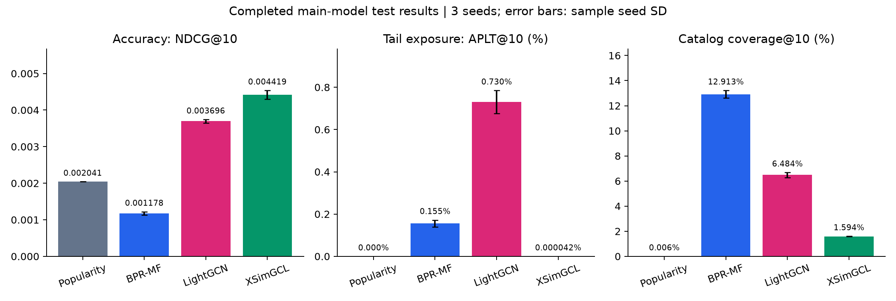
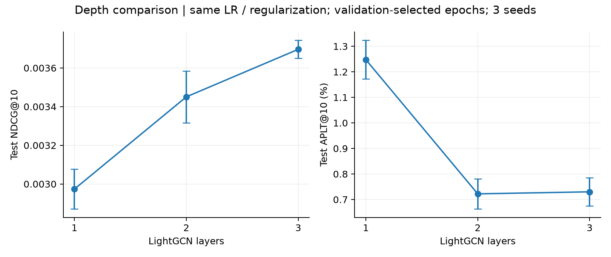

# Automotive 추천 실험 결과 정리

> 보존한 과거 기록: 아래는 **31/32개 시점 스냅샷**이다. 2026-11-10 재확인에서 32/32개 완료를 확인했으며, CL=0 3-seed·paired CI를 포함한 최신 결과는 [RESULTS_FINAL.md](RESULTS_FINAL.md)에 있다. 아래 본문은 당시 상태를 유지한다.

기록 기준: 2026-11-07 04:57 KST. 캠페인 `automotive-20261104T204146Z`.

**주 비교 3모델×3 seed와 Popularity test 평가는 완료됐다. 전체 캠페인은 31/32개 완료이며, 마지막 `xsimgcl_cl0` seed 44 보조 실험이 진행 중이다. 이 문서는 완료된 결과의 검증 스냅샷이며 최종 캠페인 완료 보고서가 아니다.**

## 핵심 결과

XSimGCL의 test NDCG@10이 가장 높다. LightGCN 대비 **19.56%**, Popularity 대비 **116.47%** 높다. 반면 비인기 상품 노출은 거의 0이다. 이번 조건에서는 대조학습의 정확도 개선과 비인기 노출 개선이 함께 나타나지 않았다.

| 모델 | 반복 | NDCG@10 평균 ± seed SD | Recall@10 평균 | APLT@10 (%) | Coverage@10 (%) | ARP@10 |
|---|---|---|---|---|---|---|
| Popularity | 결정적 1회 | 0.00204150 (SD 해당 없음) | 0.00369687 | 0.00000000 | 0.0056 | 3088.80 |
| BPR-MF | 3 seeds | 0.00117841 ± 0.00004268 | 0.00202953 | 0.15524280 | 12.9130 | 1008.77 |
| LightGCN | 3 seeds | 0.00369642 ± 0.00004705 | 0.00620172 | 0.73011975 | 6.4841 | 1597.52 |
| XSimGCL | 3 seeds | 0.00441927 ± 0.00011744 | 0.00724502 | 0.00004198 | 1.5942 | 1101.26 |

NDCG/Recall은 비율 원값, APLT/Coverage는 %다. APLT는 상위 10개 추천 중 비인기 상품 비율, ARP는 추천 상품의 학습 상호작용 수 평균이다. 오차는 사용자 CI가 아니라 seed 3개 간 sample SD(ddof=1)다.

- BPR-MF는 현재 설정 탐색 범위에서 Popularity보다 NDCG가 42.28% 낮다. 개인화 모델이 항상 인기순보다 우수하다는 주장은 지지되지 않는다.
- LightGCN은 Popularity 대비 NDCG가 81.06% 높고, 주 비교 중 APLT도 가장 높다. 정확도와 비인기 노출을 함께 볼 때 후보가 된다.
- XSimGCL은 정확도가 가장 높지만 APLT는 0.00004198%, coverage는 1.59%다. 비인기 추천을 늘렸다고 해석할 수 없다.
- XSimGCL의 ARP는 LightGCN보다 낮지만 APLT도 낮다. ARP 감소를 tail 노출 증가와 같은 뜻으로 해석하면 안 된다.

## 사용자 활동 그룹

| 그룹 | 사용자 수 | Popularity NDCG | BPR-MF NDCG | LightGCN NDCG | XSimGCL NDCG |
|---|---|---|---|---|---|
| 1-5 | 87394 | 0.00202763 | 0.00098385 | 0.00384421 | 0.00452857 |
| 6+ | 71411 | 0.00205846 | 0.00141651 | 0.00351555 | 0.00428551 |

그룹은 train 이력 수로만 정의했다. 두 그룹 모두 XSimGCL의 평균 NDCG가 가장 높다. 이 결과를 cold-start(이력 0개) 성능으로 일반화하지 않는다.

## LightGCN 층 수 비교

| 층 수 | NDCG 평균 ± SD | APLT (%) | Coverage (%) |
|---|---|---|---|
| 1 | 0.00297372 ± 0.00010307 | 1.247799 | 9.2218 |
| 2 | 0.00345064 ± 0.00013362 | 0.722123 | 8.6588 |
| 3 | 0.00369642 ± 0.00004705 | 0.730120 | 6.4841 |

1층→3층에서 NDCG는 24.30% 높고, APLT는 41.49% 낮다. 다만 APLT는 2층→3층에서 조금 올라가므로 '깊이에 따라 단조 감소'한다고 쓰면 안 된다. 층별 동일 LR/정규화를 사용하고 각 실행의 best epoch는 valid로 선택했다.

## 대조 손실 제거 보조 실험: 아직 미완료

| 완료된 동일 seed만 비교 | seed | NDCG 평균 | APLT (%) |
|---|---|---|---|
| XSimGCL CL=0 | [42, 43] | 0.00412131 | 0.07103051 |
| XSimGCL CL=0.1 | [42, 43] | 0.00441011 | 0.00003149 |

완료된 동일 seed [42, 43]만 비교하면 CL 사용 시 NDCG가 7.01% 높지만 tail 노출은 낮다. **이 표는 2-seed 중간 결과이며 3-seed 최종 결론이 아니다.** CL=0 두 실행은 모두 100 epoch 상한에 도달했다(best epoch: [75, 60]). 충분한 수렴 여부가 미확정이므로 '대조학습이 항상 우월하다'고 일반화하지 않는다. encoder/noise와 나머지 설정을 유지한 비교지만 원 논문의 모든 recipe를 재현한 것은 아니다.

## seed별 결과와 학습 시간

| 모델 | seed | test NDCG | 종료 epoch | best epoch | 기록된 GPU 학습(분) |
|---|---|---|---|---|---|
| BPR-MF | 42 | 0.00116259 | 45 | 5 | 15.2 |
| BPR-MF | 43 | 0.00122674 | 45 | 5 | 14.8 |
| BPR-MF | 44 | 0.00114590 | 45 | 5 | 15.3 |
| LightGCN | 42 | 0.00367097 | 55 | 15 | 62.6 |
| LightGCN | 43 | 0.00375072 | 55 | 15 | 62.0 |
| LightGCN | 44 | 0.00366757 | 55 | 15 | 61.2 |
| XSimGCL | 42 | 0.00429374 | 50 | 10 | 116.6 |
| XSimGCL | 43 | 0.00452647 | 50 | 10 | 117.3 |
| XSimGCL | 44 | 0.00443760 | 50 | 10 | 117.6 |

학습 시간은 history의 epoch training_seconds 합계다. 검증·Drive 전송·재시도·유실 후 재계산·test 평가를 포함한 전체 소요 시간이 아니다. 재개 시 summary.elapsed_seconds는 구간 기준일 수 있어 캠페인 전체 시간으로 합산하지 않았다.

| 모델 | LR | L2 계수 | 층 수 | CL 계수 |
|---|---|---|---|---|
| BPR-MF | 0.003 | 1e-05 | 미사용 | 미사용 |
| LightGCN | 0.003 | 1e-05 | 3 | 미사용 |
| XSimGCL | 0.001 | 0.0001 | 3 | 0.1 |

공통 dim=64, batch=8192, fused Adam, FP32. XSimGCL eps=0.1, temperature=0.2. valid를 1 epoch와 이후 매 5 epoch 평가하고, 8회 연속 개선이 없으면 조기 종료했다. 설정 고정 후 seed 42/43/44 test를 평가했다.

## 범위·검증·남은 일

- 전달받은 전처리 5-core, train만 학습. train 4,818,321개, 사용자 599,742명, 상품 248,186개다. test는 warm-start 158,805명/333,797개 정답이며 원래 test 상호작용의 약 55.2%다.
- 전체 학습 상품에서 seen_for_test를 제외하고 평가했다. 사용자별 macro 평균이며 sampled-negative 점수가 아니다. test로 설정·epoch를 고르지 않았다.
- 완료된 17개 final 기록의 입력 fingerprint·plan hash·frozen 설정·연속 epoch history·test cohort·그룹 가중 집계 일치를 검사했다. 주 비교 9개가 모두 학습 seed와 test 평가를 갖춘 것을 확인했다.
- XSimGCL 후보 Recall@100의 사용자 평균은 3.296%다. 절대 정확도와 tail 정답 회수율은 낮고, 후보 100개 안에서만 재정렬하는 방식에도 누락 한계가 있다.
- 모든 주 모델의 Tail Recall@10은 사실상 0이다. LightGCN도 3-seed 평균이 매우 작아 비인기 노출 증가를 비인기 정답 추천 성공으로 바꿔 말하면 안 된다.
- XSimGCL은 공통 raw-embedding squared L2를 적용한 recipe variant다. LightGCN과의 차이를 대조 손실 하나의 인과 효과로 단정하지 않는다. 제한된 4개 설정/모델 coarse 탐색 결과이며 SOTA나 최적 튜닝을 주장하지 않는다.
- 사용자별 paired bootstrap 95% CI는 아직 전체 캠페인의 최종 자동 보고서 생성 전이다. 여기서는 통계적 유의성을 선언하지 않는다. seed SD와 사용자 CI를 혼동하지 않는다.
- 텍스트·차종 특징 미제공으로 재정렬·차종 Mismatch는 미실시다. 미계산 값을 0으로 쓰지 않았다.
- 비용 관측: 2026-11-06T19:56:53.859341+00:00에 계정 잔액 감소 71.07 CU, 잔액 103.86 CU. 다른 동시 작업/준비 구간을 포함할 수 있어 모델별 정확한 CU 비용으로 배분하지 않는다.
- 남은 작업: CL=0 seed 44 완료 → test 평가 → 3-seed 보조 실험 집계·paired CI·자동 최종 보고서 → GPU 반납. 현재 기록 기준 약 2–3시간 예상이나 Colab 재할당·전송 대기로 늘어날 수 있다. 본 문서의 주 모델 확정 결과는 마지막 보조 실험 때문에 다시 학습하지 않는다.

## 발표에 쓸 결론

> 동일한 warm-start 전체 상품 평가에서 XSimGCL이 가장 높은 정확도를 기록했고, LightGCN은 정확도와 비인기 상품 노출을 함께 고려할 때 유용한 비교 대상이었다. 그러나 XSimGCL의 비인기 노출은 거의 0으로, 그래프 대조학습이 인기 편향을 완화한다는 가설은 본 데이터와 설정에서 지지되지 않았다.

주 비교 원본 CSV: [main_comparison.csv](results/2026-11-07/main_comparison.csv). [그룹별](results/2026-11-07/group_comparison.csv), [seed별](results/2026-11-07/completed_seed_results.csv), [층별](results/2026-11-07/depth_comparison.csv), [검증 기록](results/2026-11-07/verification.json).

동결 선택 시각: `2026-11-05T15:14:05.752621+00:00`. 모델 소스 revision: `060f5a312a15f9a4469452bb6637b09ec792a4b6`. plan SHA-256: `577676ff4d1a74ca7688b24f9ba18aaa3a7b83f91e4d5faf6c264d3171a5a237`. raw 모델/추천/사용자별 출력은 Git에 넣지 않고 캠페인 Drive에 보관한다.
