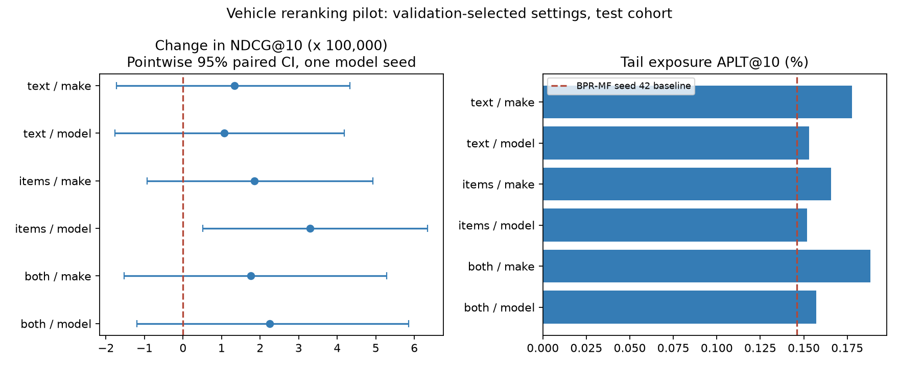

# 차종 데이터 재정렬 파일럿 — 2026-11-11

BPR-MF seed 42의 기존 추천에 차종 가점을 더한 탐색 실험이다. 사전 지정한 A1+A2·모델 일치 조건의 test NDCG@10은 **0.00116259 → 0.00118502 (+1.93%)**다.

## 평가 조건

- 어제 회의의 BPR-MF 우선·단일 seed 방향을 따른다. 기존 best checkpoint의 valid/test top-100과 점수를 재사용했으며 모델을 재학습하지 않았다.
- valid 220,516명에서 3개 출처 × 2개 일치 수준 × 8개 β = 48개 설정을 평가하고, 출처·수준별 NDCG가 가장 높은 β를 고정했다. 동점이면 작은 β다.
- frozen_selection.json을 저장한 뒤 test 158,805명 / 333,797개 정답을 평가했다. 기본 후보는 전체 train 상품 248,186개에서 이미 본 상품을 제외해 얻은 top-100이며, 새 상품 검색 효과는 이 실험 범위에 없다.
- A1은 train 기간 리뷰의 차종, A2는 train 기간 리뷰 상품 중 같은 차에 맞는 서로 다른 상품이 2개 이상인 추론이다. valid/test용 확장 프로필은 사용하지 않았다.
- 여러 차종 중 하나라도 일치하면 가점. 제조사/모델 표기는 앞뒤 공백 정리·소문자 변환만 하고 새 별칭 규칙은 만들지 않았다. 연식은 사용하지 않았다.
- 조정 점수 = 원 점수 + β × 사용자별 top-100 점수 범위 × 일치 여부. 범위가 0이면 1. β는 0/0.02/0.05/0.1/0.2/0.5/1/2다. float64 CUDA 정렬, score 내림차순·iid 오름차순이다.
- 정보 없음과 범용 상품은 unknown이며 가점·감점이 없다. β=0의 순위와 지표가 보관된 baseline과 일치하는지 확인했다.

## 동결한 설정의 test 결과

| 차종 출처 | 수준 | valid 선택 β | NDCG@10 | 기본 대비 | APLT@10 (%) | 판정 가능한 추천 (%) | 추론 불일치 (%) |
|---|---|---:|---:|---:|---:|---:|---:|
| A1 리뷰 | make | 0.5 | 0.00117590 | +1.15% | 0.1778 | 11.77 | 33.85 |
| A1 리뷰 | model | 1 | 0.00117321 | +0.91% | 0.1532 | 7.26 | 66.47 |
| A2 상품 | make | 0.5 | 0.00118109 | +1.59% | 0.1657 | 8.49 | 30.29 |
| A2 상품 | model | 1 | 0.00119558 | +2.84% | 0.1518 | 5.26 | 55.05 |
| A1+A2 | make | 0.5 | 0.00118022 | +1.52% | 0.1883 | 15.29 | 31.63 |
| A1+A2 | model | 1 | 0.00118502 | +1.93% | 0.1570 | 9.49 | 59.86 |

기본 BPR-MF의 APLT@10은 0.1462%다. 주 조건의 NDCG 차이는 +0.00002244, 사용자 paired bootstrap 95% CI는 [-0.00001201, +0.00005845]다. 학습 seed 간 변동에 대한 CI는 아니다.

## 해석과 남은 범위

- A2·모델 일치는 NDCG +2.84%이고 보정 전 paired CI가 0보다 높았다. 6개 출처/수준을 비교한 탐색 결과이므로 다중 비교와 다른 seed의 재현을 고려해 후속 후보로 해석한다.
- 위 불일치는 추출 규칙상 판단한 mismatch이며 실제 장착 불가의 확정값이 아니다. 분모는 차종을 판단할 수 있는 추천 쌍(일치+불일치)이고 unknown은 제외했다. 분모가 바뀔 수 있어 판정 coverage도 함께 보고한다.
- 가점에 사용한 정보로 불일치도 측정하므로 그 감소 자체는 독립적인 효과 검증이 아니다. NDCG·Recall 변화와 원자료 추출 품질을 함께 확인해야 한다.
- 단일 seed·하나의 후보 생성기·valid 탐색 결과다. 다른 모델·다른 seed의 개선이나 차종 특징을 넣어 재학습한 효과로 일반화하지 않는다.
- 상품 제목의 관측 시점은 제공되지 않아 과거 시점 메타데이터 정합성은 검증하지 못했다. 사용자 프로필의 last_seen이 valid 시작보다 이른지는 실제 데이터로 검사했다.
- 제공 README의 A1/A2 추출 품질 수치와 Spark 처리 시간은 공급자 보고값이다. 이 파일럿에서 독립적으로 재현한 값으로 사용하지 않는다.
- 공급자 README에는 test 상호작용에 대한 출처별 일치율과 정제 전후 비교가 포함돼 있다. 이 파일럿의 β는 valid로만 선택했지만, 특징 개발 과정까지 test와 완전히 독립된 최종 검증으로 보지는 않는다.

## 실행·검증·보관

- 장치 NVIDIA L4, PyTorch 2.14.1+cu130, CUDA 13.0. 평가 본체 30.2초. 전송·패키지 설치 시간은 별도다.
- 본체 peak RSS 2997 MiB, CUDA peak allocated 1965 MiB. idle 메모리 수치가 아니다.
- 계정 잔액 100.14 → 99.65 CU, 관측 차이 0.49 CU. 종료 후 활성 할당 0개·CU 소모율 0 확인.
- 입력/source SHA-256, 원래 baseline 지표 재현, 전체 cohort·seen 마스킹, train-only 프로필 timestamp, CPU/CUDA 표본 순위 일치를 검사했다.
- 첫 세션의 연결 오류, 분리 환경 생성 시 pip 부재, 큰 파일 회수 지연을 복구했다. 완료 묶음은 17개 조각과 전체 SHA-256을 대조해 회수했다. 세부 검증은 verification.json에 있다.
- 집계 자료: [results/vehicle-pilot-2026-11-11](results/vehicle-pilot-2026-11-11/). 원본 README 사본은 [sources](sources/vehicles-readme-2026-11-11.txt).
- 원본 Parquet·사용자별 지표·top10 추천·세션 notebook·로그·회수 archive는 Git 제외 `results/vehicle-pilot-20261111/`에 있다. 원본 데이터와 완료된 32개 캠페인은 수정하지 않았다.
- 재실행은 `scripts/colab_vehicle_pilot.py --session <새 이름> --directory <입력 3개가 있는 별도 results 경로>`를 프로젝트 Python으로 실행한다. 새 Colab L4 비용이 발생하며 자동 종료한다.
